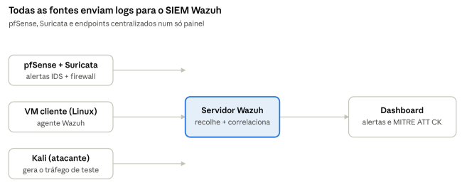

# SIEM com Wazuh — Centralização de Logs e Deteção de Ameaças

SIEM construído com **Wazuh** para centralizar e correlacionar os registos de segurança de uma rede segmentada (ver Projeto 3). O servidor Wazuh, instalado numa VM Debian na rede de gestão, recebe por syslog os eventos da firewall pfSense, monitoriza endpoints através de um agente, e apresenta tudo num painel com deteções mapeadas a MITRE ATT&CK. Fecha a narrativa de blue team: **atacou → a firewall bloqueou → o IDS detetou → o SIEM centralizou e correlacionou**.

`Wazuh 4.14` · `Debian 13` · `syslog` · `pfSense` · `Suricata` · `MITRE ATT&CK` · `CIS Controls v8` · `NIST CSF`

## Objetivo e competências

Centralizar os registos de segurança de uma rede num SIEM, com monitorização de endpoints e correlação de eventos — a base do trabalho de um analista de SOC / blue team.

- Instalação e administração de um **SIEM (Wazuh)** em Linux
- **Centralização de logs** por syslog e **monitorização de endpoints** por agente
- Triagem de alertas em dashboards, mapeados a **MITRE ATT&CK** e a normas (PCI, GDPR, HIPAA, NIST)
- Administração de Linux (Debian): instalação, configuração, serviços, utilizadores
- Diagnóstico de problemas reais até ao serviço funcional

## Arquitetura



| Componente | Onde | Endereço |
| --- | --- | --- |
| Servidor Wazuh | VM Debian 13, rede de gestão | 10.10.10.13 |
| Dashboard | acedido do host | https://10.10.10.13 |
| Fonte de logs | pfSense + Suricata | 10.10.10.1 → syslog :514 |
| Agente monitorizado | Kali, segmento de laboratório | 10.10.30.101 (portas 1514-1515) |

## Implementação

**Servidor.** Instalado com o instalador all-in-one numa VM Debian:

```
curl -sO https://packages.wazuh.com/4.14/wazuh-install.sh
sudo bash ./wazuh-install.sh -a
```

**Receção de syslog.** Bloco `<remote>` dedicado no `/var/ossec/etc/ossec.conf`:

```
<remote>
  <connection>syslog</connection>
  <port>514</port>
  <protocol>udp</protocol>
  <allowed-ips>10.10.10.0/24</allowed-ips>
</remote>
```

**Envio do pfSense.** Remote logging ativado para `10.10.10.13:514`.

**Agente.** Instalado na Kali (segmento de laboratório); para ele comunicar com o SIEM na gestão, foi aberta no pfSense apenas a exceção necessária (portas 1514-1515 para `10.10.10.13`), mantendo a política deny-by-default.

## Validação (provas)

- **Logs do pfSense no SIEM** — eventos com `location: 10.10.10.1` no Discover.
- **Deteção de ataque** — brute-force SSH detetado, `rule.level: 10`, mapeado a **MITRE ATT&CK T1110 (Brute Force, Credential Access)**.
- **Endpoint monitorizado** — agente `kali-lab` (10.10.30.101) com estado **Active**.

Screenshots em `/provas`.

## Problemas encontrados e resolução

- **OVA do Wazuh presa no arranque** → instalação de raiz em Debian com o instalador all-in-one.
- **DHCP a falhar** → o pfSense estava desligado; lição: o pfSense liga sempre primeiro.
- **Utilizador sem sudo** → `su -` + `usermod -aG sudo <user>`.
- **Bloco syslog mal colocado no ossec.conf** → fechar e abrir um `<remote>` próprio.
- **Agente "pending"** → faltava abrir a porta 1515 (enrollment) além da 1514 (comunicação) no pfSense.

## Mapeamento a frameworks

| Controlo | CIS Controls v8 | NIST CSF |
| --- | --- | --- |
| Centralização e análise de logs (SIEM) | 8 | DE.AE / DE.CM |
| Monitorização de endpoints (agente) | 8 · 10 | DE.CM |
| Deteção e correlação de ameaças | 13 | DE.AE |
| Avaliação de configuração (SCA/CIS) | 4 | PR.IP |

## Stack e próximos passos

**Tecnologias:** Wazuh 4.14 · Debian 13 · syslog · pfSense · Suricata · Kali Linux · MITRE ATT&CK.

**Próximos passos:** afinar os logs do pfSense/Suricata para aparecerem como alertas; reencaminhar o `eve.json` do Suricata; domínio Active Directory (Projeto 1) para deteções de ataques a domínio.
